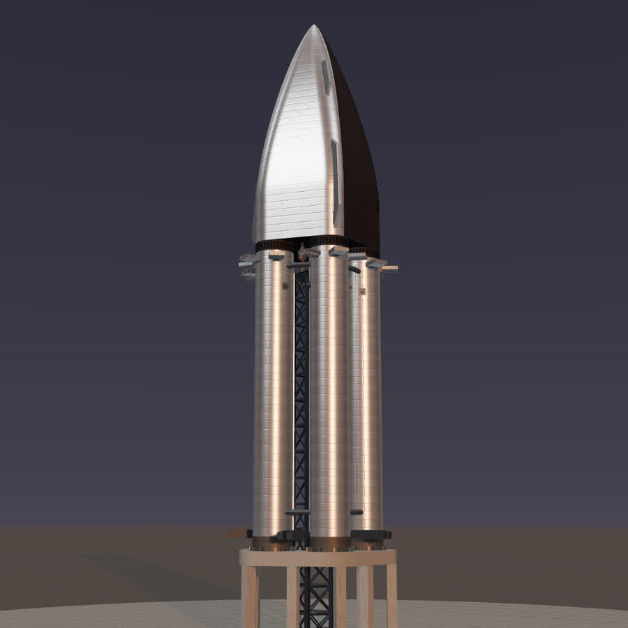
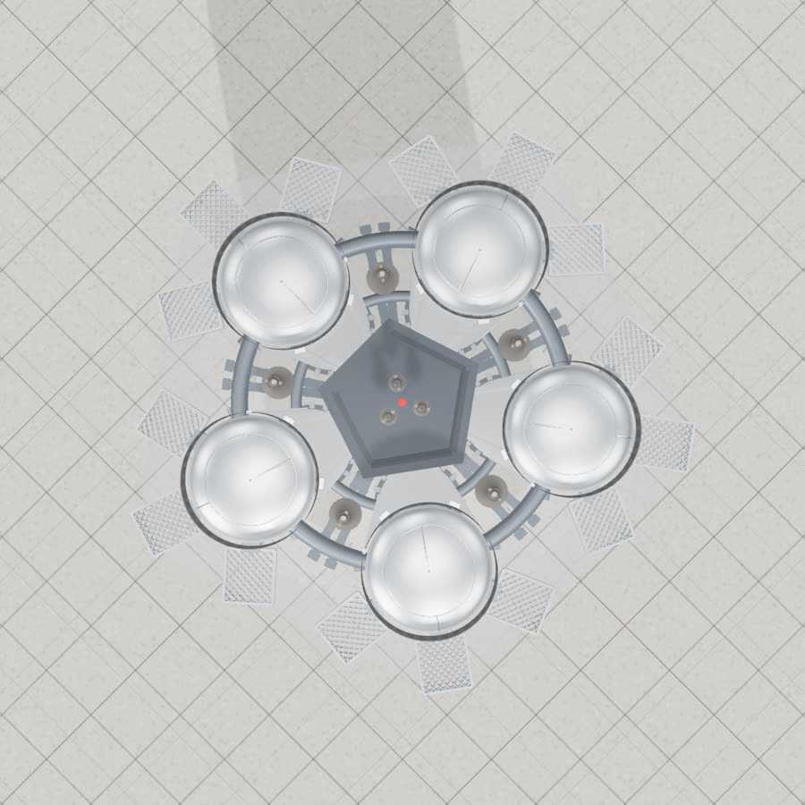
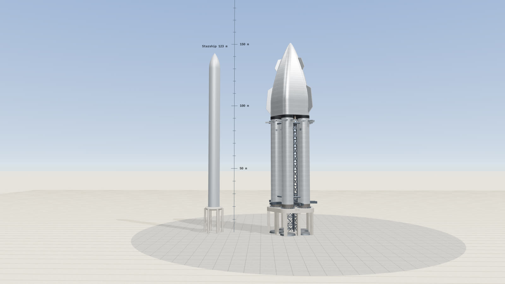

# Starship Ultra

<p>
  
  
</p>

Parametric three.js model of a multi-booster Starship concept:

- **N Super Heavy-class boosters** (default 5) with no upper stages of their own, in a ring
  around a **central lattice launch tower**.
- Two **tie rings** of minimal rods: one near the booster bases, one just under the upper stage.
  They are jettisoned at separation.
- One large **upper stage**. Its base is a rounded polygon whose corners nest the booster tops.
  Above a short straight skirt it closes in a **von Kármán nose**.
- Each tower face carries its own **carriage and pair of catch arms**. Every booster comes home
  to its own face.



## Run

No build step. Serve the folder and open it in a browser:

```sh
python3 -m http.server 8000
# open http://localhost:8000
```

three.js r160 is loaded from jsDelivr through an import map in `index.html`.

## What's modelled

| Part | Detail |
| --- | --- |
| Booster | Stainless body with ring and sheet welds, soot band over the engine bay, vented interstage ring and top dome, raceways, two catch pins, three V3-style diamond-lattice grid fins (outward and ±60°, so the tower side stays clear for the arms), 33 low-poly Raptors (3 centre, 10 inner, 20 outer) |
| Upper stage | Rounded-polygon loft with weld seams, hex heat-shield tiles over the windward ±100°, forward and aft flaps, three sea-level Raptors in the centre and one vacuum Raptor in each gap between booster tops |
| Tower | Lattice with one face per booster, top deck and beacon, five carriages, ten arms with catch rails |
| Pad | Launch table with an exhaust hole, steel ring and 20 hold-down clamps per booster, legs, steel deluge plates, concrete apron |

## Animations

Start them from **Animate** in the panel. The timeline can be scrubbed, run at ½× to 4×, and
watched with the director camera or a free orbit. Space plays and pauses; Esc exits.

- **Liftoff.** Engines start in a ripple (centre, inner ring, outer ring, booster by booster).
  Hold-down release comes at T+0. The stack climbs at ~2.5 m/s², rising as propellant burns off,
  then pitches over. The steam cloud is lit by the plumes.
- **Booster catch.** The five boosters arrive 3.5 s apart. Each one:
  1. falls engines-first about 13° off vertical, angled toward the tower, steering with its fins;
  2. lights 13 engines for the landing burn, then drops to the 3 centre engines;
  3. hovers sideways into the open arms of its own tower face;
  4. is held by the arms, which close on its catch pins, while the engines shut down;
  5. is lowered back onto the launch table.

  During powered flight the booster's tilt follows its thrust vector (trajectory acceleration
  minus gravity), so it leans the way a real one has to.

The carriages park low and open during launch, below the bottom tie ring, so nothing on the
rising stack can hit them. For the catch they ride up to just under the tower top.

## Video export

`tools/render.mjs` renders either animation frame by frame in headless Chromium. Each has its
own shot list and a telemetry overlay. ffmpeg then encodes a 1080p H.264 MP4 with a synthesized
engine track (`tools/rumble.py`, driven by the simulation's thrust log).

```sh
npm i -D playwright && npx playwright install chromium
node tools/render.mjs catch --out media      # 54 s, five staggered catches
node tools/render.mjs liftoff --out media    # 32 s, dusk
node tools/render.mjs stills --out media     # hero, plan, scale, engines, interface
```

Add `--software` on machines without a GPU. Add `--pick 120,600` to render single frames.

## Layout

| File | Role |
| --- | --- |
| `src/params.js` | Every tunable dimension, its default and its range |
| `src/geometry.js` | Shape primitives: rounded polygon, loft, Haack nose, volumes, lattice helpers |
| `src/textures.js` | Procedural steel, tiles, vents, grain and smoke textures |
| `src/parts/*.js` | Booster, Raptor, upper stage, tower and pad builders |
| `src/vehicle.js` | Assembles everything and derives the readout |
| `src/effects.js` | Plume shader and smoke particles |
| `src/animation.js` | Liftoff and catch timelines, director cameras, emitters |
| `src/main.js` | Scene, theme lighting (day or dusk), panel, playback, capture API |
| `tools/render.mjs`, `tools/rumble.py` | Video and still export |

Units are metres and the world is Y-up. Booster *k* sits at angle π/N + 2πk/N.
`window.ultra` exposes the scene, camera and a `skip(seconds)` helper in the browser console.

## Upper-stage shape

At height *y* above its base, the cross-section is a rounded N-gon with flat-edge half-width
*a* and corner radius *r*:

- **Skirt** (`y ≤ skirt`): *a = a₀*, *r = r₀ = booster radius + corner gap*. The corner arcs are
  concentric with the booster axes.
- **Nose**, with *t* running from 0 to 1 above the skirt: *a = a₀ · Haack(t, C)*.
  - *C = 0* is the von Kármán ogive, the minimum-wave-drag body for a given length and base
    area.
  - The profile is tangent to the skirt and ends in a *x^0.75* tip.
  - *r/a* grows toward a circle along *t^roundingCurve*.

## Readout

- Stack height, base widths, upper-stage envelope volume, and upper ÷ booster volume against
  today's stack.
- **Nose fineness** (length ÷ equivalent base diameter) and the slender-body **wave-drag index**
  *(D/L)²*.
- **Nose drag per booster vs Starship**: wave-drag index × frontal area ÷ booster count, relative
  to a single Starship.
- **Clearances**:
  - booster to tower, and tie rods to tower
  - tower top to the upper-stage engines
  - booster to booster
  - catch arms under the tower top, and parked arms under the bottom ring
  - booster inset vs the straight skirt

**Copy parameters** puts the current values on the clipboard as JSON, for pasting back into a
conversation or into `src/params.js`.

---

Concept study. Not affiliated with SpaceX.
